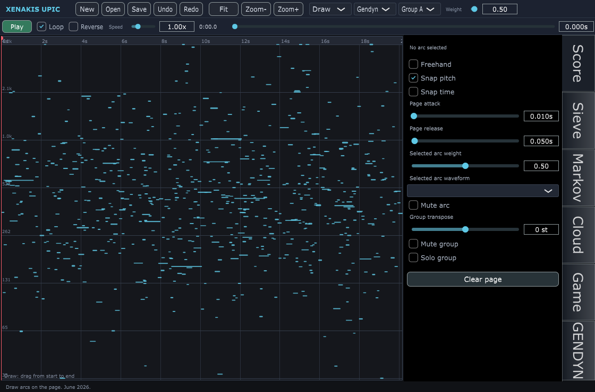

# Xenakis Tools

An independent, source-available suite of composing and synthesis tools built from
the algorithms in Iannis Xenakis's *Formalized Music*, plus a modern expansion of
the **UPIC** graphical score idea.

[Latest release](https://github.com/tkleisas/XenAudioTools/releases/latest)

The suite is three things sharing one engine:

- **`lib/`** — a header-only C++17 library (`xen`) implementing sieves, dynamic
  stochastic synthesis (GENDYN), Markov chains, stochastic clouds, game-theoretic
  strategy, and the UPIC arc model.
- **`vst3/`** — **Xenakis UPIC**, a JUCE 7 VST3 instrument for YAWN and other VST3
  hosts, with a drawn-arc score editor and generator panels for every concept.
- **`app/`** — **Xenakis UPIC Studio**, a standalone JUCE application that uses the
  same engine and the same editor without a DAW.

Eight playable `.xenpage` presets are in [`presets/`](presets/).



*Xenakis UPIC Studio playing the stochastic-cloud preset: UPIC-style arcs on the
left, generator and voice panels on the right.*

## What is implemented

| Book | Concept | Code | UI |
|---|---|---|---|
| Ch. I, V, IX | Free stochastic clouds, granular sound-points | `lib/include/xen/clouds.h` | **Clouds** tab |
| Ch. II–III | Markovian stochastic music | `lib/include/xen/markov.h` | **Markov** tab |
| Ch. IV | Musical strategy (payoff games, mixed strategies) | `lib/include/xen/strategy.h` | **Strategy** tab |
| Ch. XI–XII | Sieves: union/intersection of congruence classes | `lib/include/xen/sieve.h` | **Sieve** tab |
| Ch. XIII | Dynamic stochastic synthesis (GENDYN) | `lib/include/xen/gendyn.h` | **GENDYN** tab |
| App. III | UPIC arcs, frequency/amplitude tables, groups, performance | `lib/include/xen/upic.h` | score canvas + **Score** tab |
| — | Shared audio engine, UPIC playback, MIDI GENDYN voices | `shared/` | transport bar |

The **Sieve** panel accepts a logical formula written as `modulus: offsets`, for
example `12: 0 2 4 5 7 9 11` (the diatonic scale). It generates arcs in three
modes: sustained **fields**, **arpeggios**, and sieve-driven **rhythms**.

The **GENDYN** panel controls the stochastic waveform engine used per arc and for
live MIDI notes: segment count, distribution (uniform, Gaussian, Cauchy, logistic,
exponential), duration/amplitude step sizes and elastic barriers, and mirror
symmetry.

## Repository layout

```
XenAudioTools/
├── lib/include/xen/        header-only algorithms and models
├── shared/                 engine + page model + serialization + generators
├── ui/                     shared JUCE editor (score canvas + panels)
├── vst3/                   Xenakis UPIC VST3 instrument
├── app/                    Xenakis UPIC Studio standalone app
├── tools/                  xen_presets preset generator
├── tests/                  self-contained unit + render tests
├── presets/                generated .xenpage examples
├── docs/concepts.md        algorithm and mapping notes
├── build.sh                configure, build, test
└── NOTICE.md               attribution and licensing notes
```

## Build

Requirements: CMake ≥ 3.24, a C++17 compiler, Git, and a JUCE 7 checkout. This
repository is set up to reuse the JUCE 7 submodule already present in
`../ans-1964/third_party/JUCE`; point `XEN_JUCE_DIR` elsewhere if you prefer.

```bash
./build.sh
```

or explicitly:

```bash
cmake -S . -B build \
  -DCMAKE_BUILD_TYPE=Release \
  -DXEN_JUCE_DIR=../ans-1964/third_party/JUCE
cmake --build build -j"$(nproc)"
ctest --test-dir build --output-on-failure
```

Options:

| Option | Default | Meaning |
|---|---|---|
| `XEN_JUCE_DIR` | `../ans-1964/third_party/JUCE` | JUCE 7 source directory |
| `XEN_VERSION` | nearest git tag, else `0.1.0` | Version embedded in the app/plugin |
| `XEN_LIBRARY_ONLY` | `OFF` | Build only `xen::core` / `xen::engine` for embedding (skips JUCE, VST3, app, tests, tools) |
| `XEN_BUILD_VST3` | `ON` | Build the VST3 instrument |
| `XEN_BUILD_APP` | `ON` | Build the standalone app |
| `XEN_BUILD_TESTS` | `ON` | Build and register unit tests |
| `XEN_BUILD_TOOLS` | `ON` | Build `xen_presets` |

## Releases and versioning

Every push and pull request is built and tested by GitHub Actions on Linux,
Windows (MSVC), and macOS (universal), plus an ASan/UBSan pass over the core
library. Pushing a tag named `v*` packages all three platforms and publishes a
GitHub release. The version comes from the tag, or from `-DXEN_VERSION=...` for a
manual build.

```bash
git tag -a v0.1.2 -m "Xenakis UPIC v0.1.2"
git push origin v0.1.2
```

Release assets:

| Asset | Contents |
|---|---|
| `xenakis-upic-<version>-linux-x86_64-vst3.zip` | `Xenakis UPIC.vst3`, presets, docs, install notes |
| `xenakis-upic-studio-<version>-linux-x86_64.tar.gz` | Standalone app, presets, docs, install notes |
| `xenakis-upic-<version>-windows-x86_64-vst3.zip` | `Xenakis UPIC.vst3`, presets, docs, install notes |
| `xenakis-upic-studio-<version>-windows-x86_64.zip` | Standalone app, presets, docs, install notes |
| `xenakis-upic-<version>-macos-universal-vst3.zip` | `Xenakis UPIC.vst3`, presets, docs, install notes |
| `xenakis-upic-studio-<version>-macos-universal.zip` | Standalone app, presets, docs, install notes |
| `SHA256SUMS` | Combined checksums |

The Linux job runs in an `ubuntu:22.04` container (glibc 2.35 floor) with JUCE
7.0.12 and ccache; the Windows job uses the installed MSVC generator; the macOS
job builds a universal arm64/x86_64 bundle. macOS builds with the macOS 15+ SDK
apply [`patches/juce-7.0.12-macos15-sdk.patch`](patches/juce-7.0.12-macos15-sdk.patch)
to JUCE 7.0.12 (CI does this automatically). Only real `v*` tags publish a release. macOS
artifacts are ad-hoc signed but not notarized, so use right-click -> Open on the
first launch. The Windows app and plugin use the Visual C++ 2015-2022 runtime,
which is normally present on Windows 10/11.

The VST3 is installed to `~/.vst3/Xenakis UPIC.vst3` after a successful local
build (`COPY_PLUGIN_AFTER_BUILD`). The standalone app is at
`build/app/XenakisUPICStudio_artefacts/Release/Xenakis UPIC Studio`. It accepts an
optional preset path:

```bash
"./build/app/XenakisUPICStudio_artefacts/Release/Xenakis UPIC Studio" \
    presets/03-gendyn-drone.xenpage
```

## Using the VST3 in YAWN

1. Build, or copy `build/vst3/XenakisUPIC_artefacts/Release/VST3/Xenakis UPIC.vst3`
   into `~/.vst3/`.
2. Add **Xenakis UPIC** to an instrument track in YAWN and open the editor.
3. Draw arcs on the score canvas, or use a generator tab and press **Generate**.
4. Press **Play** to scan the page, or play MIDI notes to hear the live GENDYN
   instrument.

The page transport (`Play`, `Loop`, `Reverse`, `Speed`, position) and page/MIDI
gains are exposed as VST3 parameters. The drawn page and all parameters are stored
in the plugin state, so YAWN projects recall them.

## UI tour

- **Score canvas** — time runs left to right, pitch runs bottom to top. Drag to
  draw an arc; the toolbar chooses the waveform, weight, group, freehand mode, and
  pitch/time snapping. `Ctrl`/`Cmd` + wheel zooms, wheel scrolls.
- **Score tab** — page attack/release envelope, selected-arc weight/waveform/mute,
  per-group transpose, mute, and solo.
- **Sieve tab** — formula, preset, field/arpeggio/rhythm mode, index range, note
  duration.
- **Markov tab** — state count, self-transition bias, note duration, seed.
- **Clouds tab** — Poisson density, pitch centre/spread, grain duration and
  amplitude.
- **Strategy tab** — payoff-matrix size, segment duration, fictitious-play vs
  replicator dynamics.
- **GENDYN tab** — the stochastic synthesis controls and MIDI attack/release.

## How the engine works

`xen::Engine` renders two things:

1. **Page playback.** All arcs are scanned at the playhead, and up to 64 active
   arcs are assigned dynamically to a persistent voice pool as they enter and
   leave. Each arc's vertical position is mapped through its frequency table
   (continuous or discrete, optionally snapped to a sieve) to Hz; its weight is
   shaped by the page envelope and group transpose. GENDYN arcs own a persistent
   `GendynVoice`. Gain is smoothed to avoid clicks.
2. **Live MIDI.** Sixteen GENDYN voices with an attack/release envelope, playable
   from any VST3 host or MIDI keyboard.

All DSP is allocation-free after `prepare()`. The edited `Page` is published to
the audio thread as an immutable `shared_ptr<const Page>`; the audio thread only
performs atomic loads and copies parameter blocks at block boundaries.

## Tests

`tests/test_xen.cpp` checks sieve arithmetic (including CRT intersections and the
inverse "points to sieve" case), tuning, Markov stationarity, GENDYN output bounds
and period updates, cloud generation, strategy convergence, UPIC interpolation and
envelopes, serialization round-trips, engine rendering, and end-to-end renders of
every generator and waveform.

```bash
ctest --test-dir build --output-on-failure
```

## Accuracy and limits

These are original implementations of published mathematical descriptions, not
transcriptions of Xenakis's own source code or recordings. Where the book leaves a
choice open (initial GENDYN polygon, barrier laws, exact distribution parameters,
envelope shapes), the implementation makes a documented, musically sensible
choice. The engine caps page playback at 64 simultaneous voices (the UPIC
hardware used 64 oscillators); a page may store many more arcs, and they are
assigned to voices as they become active, but no more than 64 sound at the same
instant. The GENDYN model is a faithful behavioural implementation, not a
bit-exact clone of any specific historical program.

## Licence and attribution

The suite is **GPL-3.0-or-later**, copyright © 2026 bokontep. JUCE 7 and the VST3
SDK are GPLv3. See [`LICENSE`](LICENSE) and [`NOTICE.md`](NOTICE.md).

This is an independent project. It is not affiliated with the Xenakis estate,
CEMAMu, Steinberg, or any hardware manufacturer. The local PDF of *Formalized
Music* is a personal reference copy and is not part of the built software or its
presets; no text, score, or recording from the book is redistributed here.
