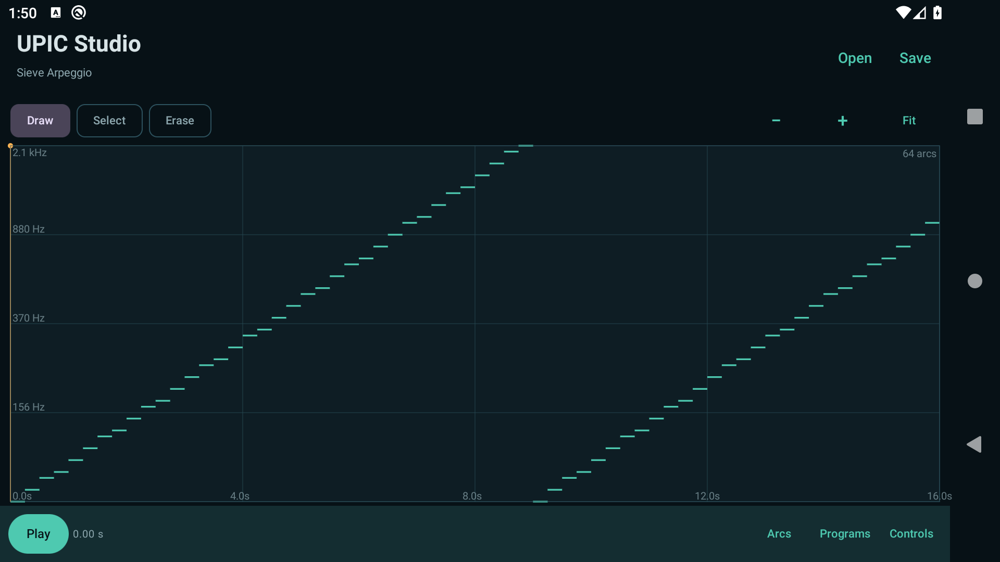

# UPIC Studio for Android

A focused Android version of Xenakis Tools. The audio engine is the same
header-only `xen` core and `xen::engine` used by the VST3/standalone products;
the UI is Kotlin + Jetpack Compose.



UPIC Studio is landscape-only. The score fills the screen; the control panel
slides in from the right over the score and can be hidden at any time.

## Features

- Generate pages with **Sieve**, **Markov**, **Cloud**, and **Strategy** models.
- Draw freehand UPIC arcs with a finger, pinch to zoom the time/pitch view, and
  drag to pan in Select/Erase mode.
- Browse every arc in a list for reliable selection, deselection, and deletion.
- Edit arc weight, waveform, group, and mute state.
- Load eight built-in UPIC programs, save edited programs to app storage, and
  keep the current page automatically between launches.
- Landscape-first workspace with a collapsible side control panel.
- Loop playback with adjustable speed and master gain.
- Live GENDYN note strip (C3–C4) for auditioning stochastic voices.
- GENDYN controls: segments, distribution, amplitude step/barrier, mirror.
- Open and save `.xenpage` files through Android's document picker.
- Native AAudio output with a lock-free UI→audio note queue and soft limiting.

## Architecture

```
app/src/main/
├── cpp/
│   ├── AudioOutput.*      AAudio stream + xen::Engine render loop
│   ├── UpicJni.cpp        JNI bridge, page generation, transport/notes
│   └── CMakeLists.txt     builds xen_engine + libupic.so
├── java/gr/tkleisas/upicstudio/
│   ├── UpicEngine.kt      JNI declarations
│   ├── PageModel.kt       .xenpage parse/serialize + page data classes
│   ├── UpicApp.kt         Compose UI, canvas, generator and GENDYN panels
│   └── MainActivity.kt
└── AndroidManifest.xml
```

The app links the `lib/` and `shared/` sources directly. No libsndfile or JUCE
dependency is required on Android.

## Build

Requirements:

- Android SDK 36, NDK `27.2.12479018`, CMake `3.22.1`
- JDK 17+ (Android Studio's bundled JBR works)
- Gradle 8.12 via the wrapper

```bash
cd android
export JAVA_HOME=/path/to/android-studio/jbr
export ANDROID_HOME=$HOME/Android/Sdk
./gradlew :app:assembleDebug
```

The APK is written to `app/build/outputs/apk/debug/app-debug.apk`. It contains
`arm64-v8a`, `armeabi-v7a`, and `x86_64` native libraries.

Android Studio: open this `android/` directory as a project.

## Play Store release

The release process is documented in [`RELEASING.md`](RELEASING.md). It covers
upload-key creation, GitHub signing secrets, signed AAB builds, Play Console
setup, Data safety answers, the privacy policy, and the `Android Release`
workflow.

```bash
android/scripts/set_version.sh 2 0.1.1
android/scripts/build_release.sh
```

Release outputs:

- `app/build/outputs/bundle/release/app-release.aab`
- `app/build/outputs/apk/release/app-release.apk`
- `app/build/outputs/mapping/release/mapping.txt`

Store metadata and graphics are under
[`fastlane/metadata/android/en-US/`](fastlane/metadata/android/en-US/).

## Current limitations

- One active page at a time, with built-in and saved program slots rather than a
  multi-track project model.
- Generators expose a compact parameter subset compared with the desktop app.
- Playback is AAudio-only; export to WAV and file sharing are future work.
- Envelope/frequency-table editing is preserved when loading/saving but not
  exposed in the mobile UI yet.

## License

The Android app is GPL-3.0-or-later. The reusable `xen` core and engine remain
dual-licensed MIT OR GPL-3.0-or-later as described in the repository root.
